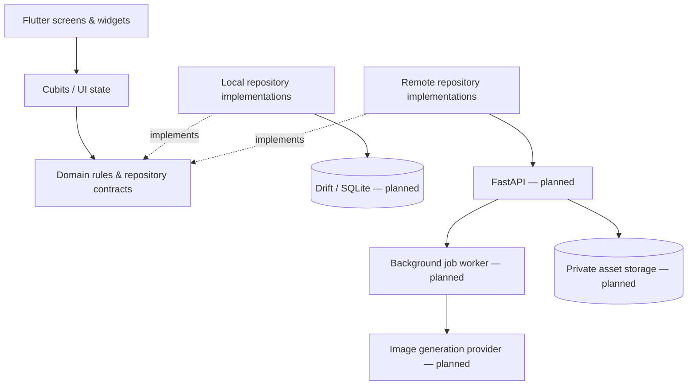

<div align="center">

# شَكْل · Shakel

### Visualize your space. Plan the change.

**An Arabic-first room redesign and renovation planning app, built with Flutter.**

From a real room photo to AI design concepts, considered choices, a shopping plan, and a budget you can track.

[](https://flutter.dev)
[](https://dart.dev)


</div>

> [!IMPORTANT]
> **Project status: early development.** Shakel is evolving from an interior-design prompt builder into an end-to-end room transformation product. The product vision and roadmap below describe **planned capabilities**, not features already available in a production release.

The [Shakel product and engineering plan](docs/product/README.md) is the
milestone reference. [M0 evidence](docs/product/M0_CURRENT_STATE.md) distinguishes
completed checks from open release gates.

## Why Shakel?

Redesigning a room involves more than finding an attractive reference image. People need to understand what might change, decide what to keep, choose between alternatives, estimate purchases, and follow progress against a budget.

**Shakel's goal** is to bring those decisions together in one project that can be revisited throughout a room's transformation.

The initial experience is designed around people furnishing or refreshing a room, with an Arabic-first interface and local budgeting needs in mind.

## Product journey

| Step | Intended experience |
| --- | --- |
| **01 · Capture** | Add a room photo, project details, optional dimensions, and a budget. |
| **02 · Personalize** | Pick a style, colors, mood, and furniture to keep, replace, or add. |
| **03 · Visualize** | Generate and save AI-assisted interior design concepts. |
| **04 · Compare** | Review design variants and select a preferred direction. |
| **05 · Plan** | Build a furniture and shopping list with clearly sourced estimates. |
| **06 · Execute** | Track actual spending, purchases, tasks, and progress over time. |

The existing prompt-composition capability is intended to become **one part of the design workflow**, not the entire product.

## Implementation status

This table deliberately distinguishes the current codebase from the target product. “Partial” does **not** imply an end-to-end verified feature.

| Area | Status | Notes |
| --- | --- | --- |
| Feature-oriented Flutter structure | **Present** | Existing app, core, and feature modules. |
| Design preferences and prompt composition | **Present / partial UI flow** | Existing prompt-focused experience; full product journey is not yet connected. |
| Room project creation and persistence | **Partial** | The current create-room flow does not complete a durable save from its final action. |
| Furniture / budget foundations | **Partial** | Domain and local-planning foundations need integration and persistence review. |
| Real AI image generation | **Planned** | Requires backend, provider integration, background jobs, and result storage. |
| Design versions and comparison | **Planned / verification required** | Not represented as a completed, tested end-to-end feature. |
| Shopping, purchases, and execution tracking | **Planned** | Part of the target MVP. |
| Automated quality gates and release validation | **Partial** | Locked dependency resolution, format, analyze, 2 tests, and development APK build pass locally on Flutter 3.32.8; PR CI and device smoke remain open. |

### Product preview

Real application screenshots and a short demonstration will be added after the relevant flows can be built, run, and captured from the app. No concept mockups are presented as shipped screens.

## Technical overview

### In the current Flutter repository

- **Flutter & Dart** — mobile application framework.
- **Cubit (`flutter_bloc`)** — presentation state management.
- **GoRouter** — declarative navigation.
- **GetIt** — dependency injection.
- **Equatable** — value-based state equality.
- **SharedPreferences and local file storage** — existing local persistence foundations, subject to redesign.
- **Feature-oriented modules** — existing separation of room creation, design logic, and room planning.

### Target architecture (planned)

The proposed design is **local-first**, with feature-oriented boundaries and repository abstractions. A separate backend will handle sensitive AI-provider access and long-running generation jobs.



Source-code dependencies should point **toward domain contracts**; the diagram shows the proposed runtime collaboration rather than package import direction.

**Engineering principles:** separation of concerns, incremental migration, testable boundaries, explicit failure states, no mobile-side provider secrets, and evidence-based release criteria.

## Repository layout

```text
roomgenius_mobile/
├── .github/workflows/      # Workflow definitions (results require verification)
├── android/                # Android host project
├── assets/                 # App images, icons, and fonts
├── docs/                   # Project documentation (being aligned with Shakel)
├── integration_test/       # Integration test sources
├── lib/
│   ├── app/                # Bootstrap, configuration, routing, and DI
│   ├── core/               # Shared application foundations
│   └── features/           # Feature-oriented application modules
├── test/                   # Test sources
├── tools/                  # Development utilities
├── web/                    # Web host files (not a verified release target)
├── CONTRIBUTING.md
├── CHANGELOG.md
└── pubspec.yaml
```

## Getting started

### Prerequisites

- Flutter 3.32.8 through FVM (`.fvmrc`), with Dart 3.8.1.
- An Android development environment and a configured emulator or physical device.
- Any platform-specific configuration required by the checked-out revision.

### Run the development entry point

```bash
git clone https://github.com/mostafaahmd/roomgenius-mobile.git
cd roomgenius-mobile
fvm flutter pub get --enforce-lockfile
fvm flutter run --flavor development -t lib/app/flavors/main_dev.dart
```

The Dart package is `shakel_mobile`. Android application IDs are
`com.shakel.mobile.dev` and `com.shakel.mobile`. Firebase is deferred and is
not part of the current application bootstrap or M0 build.

### Code quality and tests

```bash
fvm dart format --output=none --set-exit-if-changed .
fvm flutter analyze
fvm flutter test
```

For integration tests, configure a compatible device first and follow the test runner requirements for the test files in `integration_test/`.

> Format, analyze, and 2 tests passed locally on Flutter 3.32.8 on 2026-11-15.
> See [M0 evidence](docs/product/M0_CURRENT_STATE.md) for build blockers and
> unverified gates. Record CI and device results in pull requests.

## Delivery roadmap

Shakel is developed through incremental, verifiable milestones. The MVP is complete only after the relevant user journey is demonstrably working.

| Milestone | Outcome |
| --- | --- |
| **M0 · Foundation** | Technical Shakel rename, reproducible builds, repository cleanup, baseline tests, CI, product and architecture decisions. |
| **M1 · Domain & persistence** | Unified project model, safe local persistence, and migration tests. |
| **M2 · Project creation** | Create, save, resume, edit, and reopen a room project. |
| **M3 · AI generation** | Secure backend-mediated image generation with durable job handling. |
| **M4 · Design comparison** | Save, compare, and select design variants. |
| **M5 · Shopping & budget** | Itemized estimates, price provenance, purchases, and accurate budget calculations. |
| **M6 · Execution** | Tasks, progress, and ongoing room project tracking. |
| **M7 · Release hardening** | Security, accessibility, reliability, tests, monitoring, and release validation. |
| **M8 · Advanced capabilities** | Optional AI refinement, product matching, and commerce integrations after validation. |

**Outside the initial MVP:** precise dimension extraction from one image, CAD-grade architectural accuracy, AR/3D room planning, a proprietary marketplace, and unverified real-time retail prices.

## Product and engineering guardrails

- Generated design images are **visual concepts**, not engineering drawings or guarantees of physical fit.
- Estimated prices must show their source and should never be labeled “live” without verification.
- Photos of private spaces require clear consent, appropriate access control, and a documented deletion policy before cloud processing is released.
- A task is not “done” merely because its UI exists: expected behavior, error handling, and tests matter.
- README descriptions, screenshots, and badges must reflect **verified reality**, not the intended final release.

## Contributing and project updates

Changes should be made through short-lived branches and pull requests. See [CONTRIBUTING.md](CONTRIBUTING.md) for branch naming and commit conventions; see [CHANGELOG.md](CHANGELOG.md) for the recorded changes.

Bug reports and proposals can be discussed through [GitHub Issues](https://github.com/mostafaahmd/roomgenius-mobile/issues).

## License

No license file is currently published in this repository. Public visibility does not itself grant permission to reuse or redistribute the source. A license policy can be added when the project's distribution and contribution model is decided.

---

<div align="center">

**Shakel · شَكْل**
*Design with intention. Build with evidence.*

</div>
